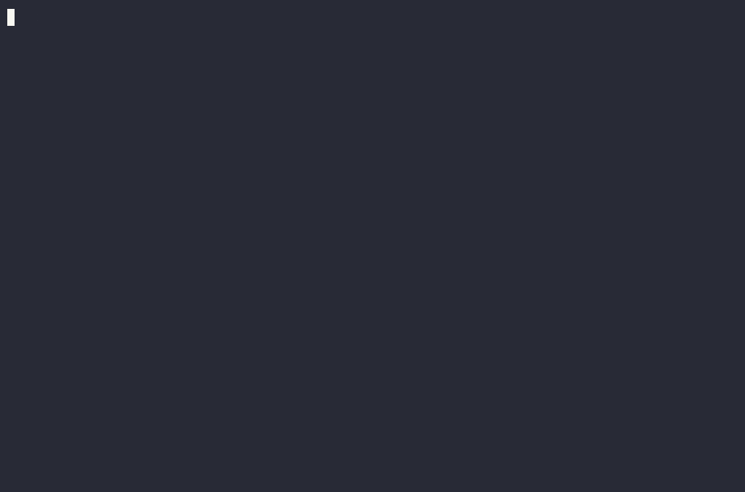

<p align="center">
  
</p>

<h1 align="center">TodoMD</h1>

<p align="center">
  A Kanban TUI and agent-friendly CLI over a plain markdown <code>TODO.md</code>.
</p>



The markdown file is the single source of truth — readable and diffable for
humans, renderable on GitHub, and deterministic for the tool. Humans use the
TUI; AI agents drive the CLI (`--json` everywhere, stable task IDs, meaningful
exit codes).

## 📦 Install

macOS or Linux — installs (and updates) the latest release to
`~/.local/bin`, verifying the checksum:

```sh
curl -fsSL https://raw.githubusercontent.com/walm/todomd/main/install.sh | sh
```

Or grab a binary from the
[releases page](https://github.com/walm/todomd/releases), or build from
source:

```sh
go install github.com/walm/todomd@latest   # or: go build -o todomd .
```

`todomd --version` prints the version.

### Upgrading

```sh
todomd upgrade          # download the latest release and replace this binary
todomd upgrade --check  # just report what's available
```

It verifies the release's published sha256 before swapping the binary, and
leaves the old one in place if anything fails. If todomd lives somewhere you
can't write, it says so rather than half-upgrading. (Re-running the install
script above works too, and is the right move for a source build.)

todomd mentions a newer release **only where a human is looking**: in the TUI
footer and at the end of `todomd --help` (on stderr, so `--help` output itself
is unchanged). No other command ever prints it, so scripts and agents are
unaffected. The check runs at most once a day, in the background, from a
cached answer — and `TODOMD_NO_UPDATE_CHECK=1` turns it off entirely.

## 🚀 Quick start

```sh
todomd init                 # creates TODO.md with Backlog / In Progress / Done
todomd                      # opens the Kanban TUI
```

## 🧠 Agents

Give a coding agent (Claude Code, Codex, …) the board in two steps:

```sh
todomd skill --install      # writes .claude/skills/todomd/SKILL.md
                            # (or: todomd skill > AGENTS-todomd.md, for other agents)
```

then tell the agent to watch the board. The skill teaches it the CLI —
reading cards (`list`, `show`, `--json`), writing as itself
(`comment --author agent --as agent`, `move`, `add`, `update`), attachments
(`attach`, `download`) — and the loop:

```sh
todomd watch --as agent --no-wait --json   # once: sync, start tracking
todomd list --json                         # read the board
todomd watch --as agent --json             # wait; print what changed; exit
# handle the events, run watch again
```

`watch` syncs with todomd.online itself (before, during and after each wait)
when the file is linked, and just waits on a local one, so the same skill
works for both. Its default board rules: a new card in Backlog gets one
short answer and no work; "GO" (or a move to In Progress) starts the work,
with short progress comments; when done, a comment on what changed and how
to check it, and a move to Done; when stuck, a question on the card; cards
are never deleted. The rules are yours: edit the installed `SKILL.md`, or
tell the agent otherwise. `todomd skill` prints the text without installing;
`--install --dir <dir>` puts it elsewhere and `--force` overwrites.

## 🤖 CLI (for agents and scripts)

```sh
todomd add "Fix the parser" --tag parser --priority high --due 2026-08-01 --json
todomd list --priority high --json    # what to work on first
todomd list --json                    # everything, grouped by board
todomd show 3f2a --json               # full task detail
todomd update 3f2a --title "New" --priority low --tag a --clear-due
todomd move 3f2a --to "In Progress" --pos 1
todomd done 3f2a
todomd comment 3f2a --author ai "Tried X, going with Y."
todomd delete 3f2a --yes
todomd split 3f2a "Part one" "Part two"   # new cards linked "split from 3f2a"
todomd links add 9e41 blocks 3f2a     # also blocked-by, related, duplicate-of, …
todomd links 3f2a --json              # a card's links, both ways
todomd links rm 9e41 3f2a             # wherever the link is stored
todomd add "Follow-up" --link related:3f2a
todomd sticker 3f2a fire              # or 🔥, a ribbon colour (red, …), or none
todomd list --sticker any --json      # cards with a sticker (or --sticker fire, none)
todomd boards --json
todomd boards add Review              # before Done; or --after/--before <board>
todomd boards rename Review QA        # tasks and position stay
todomd boards move QA --to 1          # or --after/--before <board>
todomd boards delete Review           # --force if it still holds tasks
todomd archive --dry-run              # what clearing Done would remove
todomd changes --as claude --ignore-author claude --json
todomd watch --as claude --json       # sync, wait for changes, print them
```

### 🔄 Change tracking for agents

`todomd changes` answers "what happened since I last looked" without the
agent having to read or diff the whole file. Each consumer names a cursor
with `--as`; reading advances it (`--peek` doesn't). The first call just
initializes the cursor. Because it diffs snapshots of the file (stored under
`$XDG_STATE_HOME/todomd`, default `~/.local/state/todomd`, keyed by the
file's path), it catches *every* source of change: CLI, TUI, `$EDITOR`,
hand edits, formatters, git pulls.

Events: `task_added` (includes the full task as `detail`), `task_deleted`,
`task_moved` (`from`/`to`), `task_updated` (`fields` with old/new per
changed field — renames stay the same task, identity is the ID),
`comment_added` (the comment). Reorders within a board are not reported.
Events are about tasks: renaming a board reports a `task_moved` (old name →
new) for each of its tasks, while adding, reordering or renaming an empty
board reports nothing.

**A consumer is never notified about its own writes.** Pass the same `--as`
name when you write (or set `TODOMD_CURSOR` once) and that write is folded
into your own cursor, so it isn't reported back to you — while everyone
else's cursor still sees it. Only what *you* changed is skipped: if a human
comments on the very task you just moved, you still get that comment.

The typical agent loop:

```sh
export TODOMD_CURSOR=claude          # or pass --as claude to each call
todomd move 3f2a --to "In Progress"  # mine: won't come back as an event
todomd comment 3f2a --author claude "done, please review"
# …later…
todomd changes --json                # only what others did
todomd watch --json                  # sync, block until someone else acts
```

`todomd watch` is the agent's loop in one command: run it, handle the events
it prints, run it again. It reports what `changes` does, waiting until there
is something (or `--timeout`, default 10m, passes: no events and
`"timed_out": true`). On a file linked to todomd.online it also syncs — before
the wait (your own writes go up, the board's come down), during it (online
edits arrive live) and once more before it prints — so no separate
`todomd sync` is needed. If another process already syncs the file
(`sync --watch`, the TUI), that one does it and `watch` only waits.
`--no-wait` syncs and reports what is pending without waiting; run it once
before you stop, so your last writes go up. The first run starts the cursor
at the synced file. A run cut short by Ctrl-C or SIGTERM (an agent's tool
timeout) doesn't advance the cursor, and sync problems are printed on stderr
and under `"sync"` in `--json`. `changes --wait` still works, and syncs while
it waits, but only `watch` syncs before and after.

- **File resolution**: `--file` flag > `TODOMD_FILE` env > `TODO.md` searched
  from the cwd upward (stopping at the repo root).
- **IDs** are stable 4-char base36 (they survive renames and moves) and may be
  abbreviated to any unique prefix. Deleted IDs may be reused later — don't
  hold IDs across deletions.
- **Priority** is `high`, `normal` (the default) or `low`, on `add`/`update`
  and as a `list --priority` filter. It's advisory: the suggested convention
  is to work High first, then Normal, then Low — todomd records it and leaves
  the ordering to you. `"priority"` is always present in JSON, so an agent
  never has to infer the default.
- **Stickers** make a card stand out on the board: one per card, an emoji
  from a fixed set (fire 🔥, star ⭐, eyes 👀, wip 🚧, check ✅, target 🎯,
  zap ⚡, idea 💡, bug 🐛, ship 🚀, question ❓, heart ❤️) or a ribbon colour
  (red, amber, green, blue, violet). Set one with `todomd sticker <id>
  <name|emoji|none>`, `add --sticker` or `update --sticker`; `todomd sticker`
  lists them. JSON has `"sticker": "fire"` or `null`. A sticker isn't a tag:
  filter on tags for meaning, use a sticker to stand out.
- **Exit codes**: `0` ok · `1` general error · `2` task or board not found ·
  `3` ambiguous ID prefix · `8` board name already taken · and for
  todomd.online sync (below): `4` not logged in · `5` not linked ·
  `6` unreachable (retry later) · `7` this todomd is too old.
- Boards are matched case-insensitively and created on demand (new boards land
  before `Done`). `boards add <name>` creates an empty one there, or
  `--after`/`--before` another board. `boards rename <board> <new name>` keeps
  its tasks and position (a change of case is fine). `boards move <board>`
  takes `--to <pos>` (1-based), `--after` or `--before`. A name another
  board already has, in any case, is refused with exit code `8`.
  `boards delete <name>` removes one; an empty board goes straight away, one
  holding tasks needs `--force` because its tasks go with it. All of them
  take `--json` (the board, its position and the new board order) and
  `--as`.
- Concurrent invocations are safe: every write takes an advisory lock
  (kept in `~/.local/state/todomd`, never next to your file) and replaces
  the file atomically.
- Any text is safe to pass — titles reject newlines, and description/comment
  lines that would read as file structure are escaped on write and unescaped
  on parse. The one restriction: multi-line text must not contain an unclosed
  ``` code fence.

## ⌨️ TUI

| Keys | Action |
|---|---|
| `h`/`l` `j`/`k` | Navigate columns / cards (`g`/`G` first/last) |
| `H`/`L` | Move task to previous / next board |
| `J`/`K` | Reorder task within its board |
| `Enter` | Open task detail (modal over the board; `q`/`esc` back) |
| `a` / `e` | Add / edit task (`tab` next field, `ctrl+s` save, `esc` cancel) |
| `E` | Edit the task as markdown in `$VISUAL`/`$EDITOR` (title, tags, due, description, comments) |
| `p` | Cycle priority (normal → high → low) |
| | (in the add/edit form, priority is a `←`/`→` select) |
| `s` | Sticker picker (arrows and `enter`, `1`–`9` for the first nine emoji, `0` none) |
| `c` | Comment on task |
| `d` / `D` | Delete task (confirm) / move to Done |
| `X` | Delete the current board (asks first if it holds tasks) |
| `A` | Mark every card as read (clear all badges) |
| `/` | Search: filters as you type (`enter` keeps it, `esc` cancels); `sticker:fire`, `has:sticker` and `sticker:none` filter on stickers |
| `u` | Show only changed/unread cards |
| `esc` | Clear the active filter |
| `r` | Reload from disk |
| `?` / `q` | Toggle help / quit |

Inside the open task: `j`/`k` scroll, `ctrl+d`/`ctrl+u` half a page, `g`/`G`
jump to the top and bottom, and the title, id, board, tags, priority and due
date stay pinned above the scrolling body. Its links are listed under the
description, numbered: `1`–`9` open the linked card. `e`, `E`, `c`, `p` and `s` work there too
and return you to the task afterwards.

🖱️ Mouse works alongside the keys: click a card to select it, click it again to
open; inside the open task the footer hints (`e edit · E editor ·
c comment`) are clickable and tapping outside the card closes it. Forms use
the same style (`ctrl+s save · esc cancel`), and on the board footer
`a add`, `? help`, and `q quit` are clickable too — every actionable label
underlines on hover. Column headers select their column, and the wheel
scrolls (cards on the board, text in the open task). Terminals need
shift-click to select text for copying while mouse mode is on.

### 🔔 Unread badges

The TUI tracks what changed since *you* last looked (its own `tui` change
cursor): cards added by someone else show `●` with a green border, cards
updated/moved/commented show `○` with a yellow border, and the status line
counts them on startup. Opening a card marks it read, `A` marks the whole
board read at once; your own actions never badge; unread state persists across
sessions.

While you idle on the board, the TUI auto-reloads: it stats the file every
2s and refreshes (badging changed cards, keeping your selection) whenever
the file actually changed — so agent activity appears live. Auto-reload
pauses while a task, form, or confirm prompt is open; `r` still forces a
reload any time.

The TUI auto-detects light/dark background at startup. Set `GLAMOUR_STYLE`
(`dark`, `light`, `notty`, …) to pin the theme and skip the terminal query —
useful for terminals that don't answer OSC color queries.

## 🌐 Web UI

Prefer a browser? [**todomd-web**](https://github.com/walm/todomd-web) is a
separate application serving the same board over HTTP — one Go binary, no
database, the same `TODO.md` as the source of truth.

## ☁️ todomd.online sync

[todomd.online](https://todomd.online) hosts a board online — open it from any
browser, share it — and the CLI keeps it and your `TODO.md` in step, both ways.

```sh
todomd login            # once per machine: approve it in a browser (GitHub or an emailed code)
todomd link             # once per TODO.md: create the project, or pick one (matched by git remote)
todomd sync             # push your edits and pull the board's, merged per task
todomd sync --watch     # stay running: live in both directions
```

- **Login** shows a short code and a URL; approve the machine in any browser,
  on your phone if you're on ssh. Credentials live in
  `~/.config/todomd/hosts.json` (mode 0600). `todomd whoami` and
  `todomd logout` do what they say. Agents don't log in: they use the
  machine's login, or a project-scoped token made on the web, through
  `TODOMD_TOKEN` (or `todomd login --with-token`).
- **Sync merges, it doesn't overwrite.** Both sides' changes to different
  tasks, fields, or lines of a description combine. When both changed the
  same thing, the online version wins and yours is kept as a comment by
  `todomd-sync` on that task — nothing is lost, and the conflict is reported.
  Only changes travel, not whole files.
- **Online edits land in the file like any other edit**, through todomd's
  lock and atomic write: `todomd changes`, the TUI's unread badges and
  todomd-web all see them. With `sync --watch` running (or the TUI open on a
  linked file — it syncs on its own, showing `⇅ rev N` in the corner), an
  edit on either side shows up on the other within a couple of seconds.
- **Agents**: loop on `todomd watch --as <name> --json` — it syncs before,
  during and after each wait, so nothing else is needed. Or run
  `todomd sync --watch` in the background and keep using
  `todomd changes --json`; or call `todomd sync --json` before reading and
  after writing. `sync --json` reports `pushed` and `pulled` events in the
  `changes` schema, plus `conflicts` and `renamed_ids` (a task whose id
  collided with one added online gets a new id).
- **Git.** Once synced, todomd.online keeps the history, so `link` offers to
  stop tracking `TODO.md` in git (added to `.gitignore`, removed from the
  index only — you commit that). If you keep it in git (`--git track`), sync
  refuses a file with conflict markers in it, and a change that arrives with
  a checkout or pull never deletes anything online. A deleted `TODO.md` is
  restored from the project on the next sync, never synced as a deletion.
- `todomd sync status` shows the link, base revision and last sync;
  `todomd open` opens the board; `todomd unlink` forgets the link (the file
  and the project stay). The link lives in `~/.local/state/todomd`, next to
  the lock and cursors — never in your repository.
- `--host` / `TODOMD_HOST` point at another server, e.g. a local one for
  development (plain `http` only for localhost).

### 🖼️ Images

```sh
todomd attach 3f2a ~/Desktop/screenshot.png   # copies it in, links it from the task
todomd sync                                   # uploads it; the board online shows it
```

- In `TODO.md` an image is a **local path** — `~/.local/state/todomd/attachments/<project>/att_<hash>/<name>`
  — so an agent or the TUI opens it like any file. Online the same image is
  a todomd.online URL. Sync translates between the two by rule, so moving
  `TODO.md` changes nothing, and a path written on another machine (arriving
  through git, say) is recognised and works here too.
- **Images pasted on the web board are downloaded** on the next sync and
  linked by local path.
- **Only images in todomd's own folder are ever uploaded** — a regular file
  whose real path is inside it, whose content matches its id, PNG, JPEG, GIF
  or WebP, at most 5 MB. A link to any other file (``,
  say) is never read, let alone sent; downloads come only from the linked
  host, and the token goes nowhere else.
- Anything that can't sync keeps its link and is listed under `skipped` in
  `sync --json` (with `uploaded` and `downloaded`). `sync --no-attachments`
  moves no image bytes at all (links then stay URLs), for CI machines.
- Images attached in todomd-web are offered for copying into todomd's folder
  when you `todomd link`, after which they sync like the rest.
- **Other files** attached on the web board (a PDF, a zip, a CSV…, up to
  25 MB) stay todomd.online links in `TODO.md`; sync doesn't download them.
  Fetch one when you need it:

  ```sh
  todomd download 3f2a report.pdf -o ~/Downloads   # name or att_ id; optional if the task links to one
  ```

## 📝 The file format

```markdown
# TODO

Free-form preamble — never touched by the tool.

## Backlog

### Implement markdown parser
<!-- id:3f2a -->
`#parser` `#core` **priority:** high **due:** 2026-08-01

<!-- sticker: fire -->

Description: any markdown, multiple paragraphs, code fences, lists.

#### Links

- split from 9c41
- blocked by b7d0

#### Comments

- **ai** (2026-07-18): Considered goldmark; hand-rolled round-trips better.
- **user** (2026-07-18): Agreed.

## In Progress

## Done
```

Rules, briefly:

- `##` headings are boards (column order = file order); `###` headings are
  tasks (card order = file order). Empty boards persist.
- The `<!-- id:… -->` comment is the task's stable ID (invisible when
  rendered). Hand-added tasks without one get an ID on the next write.
- The metadata line (tags, priority, due) is the first non-blank line below
  the ID comment (formatter-inserted blank lines are fine). `**priority:**` is
  `high` or `low`; the default `normal` is left out, so ordinary tasks stay
  clean.
- A sticker is a hidden `<!-- sticker: NAME -->` line right after the
  metadata line (`fire`, `star`, …, `red`, …; ASCII names, not the emoji).
  Only that position and only a known name count; anything else is
  description text. Details: [docs/card-stickers-format.md](docs/card-stickers-format.md).
- Everything up to `#### Links` / `#### Comments` / the next heading is the
  description, preserved verbatim.
- `#### Links` lists links to other cards, one per line: `- <kind> <id>`,
  with the kinds `split from`, `split into`, `blocks`, `blocked by`,
  `related`, `duplicate of` and `duplicated by`. A link is stored on one
  card only; the other card shows it from its side (`split into`, `blocks`,
  …). If the lines under the heading aren't all such items, the heading is
  just description text. Details: [docs/card-links-format.md](docs/card-links-format.md).
- Comments are one list item each: `- **author** (YYYY-MM-DD): text`, with
  continuation lines indented two spaces.
- Hand-editing is fine; the tool re-canonicalizes spacing on its next write
  and reports malformed content with line numbers.

## ⚠️ A board, not a database

todomd is built for the *active* work of a project — a few boards, dozens of
tasks. It is not meant to hold hundreds of tasks: a board you can't read in
one glance has stopped being a board.

- **Delete Done tasks once they've been reviewed** — `todomd delete <id>
  --yes` (or `d` in the TUI). Agents should clear confirmed Done items as
  part of their loop instead of letting the board grow.
- **`todomd archive` clears the whole Done board in one go.** Because that is
  bulk and destructive it confirms first, and it refuses unless the tasks
  would survive somewhere: either the file is committed to git (so
  `git log -p TODO.md` still has them) or you pass `--to FILE` to move them
  into another markdown board. `--dry-run` previews, `--force` overrides the
  git check, `--yes` skips the prompt (required when not on a terminal).
- **Archive and history are git's job.** Keep `TODO.md` in version control
  and nothing is ever lost: every task, move, and comment lives in the
  file's history (`git log -p TODO.md`), which beats any archive board.

## 🏷️ Releasing

todomd follows [semver](https://semver.org) (0.x: minor bumps may break —
called out in [CHANGELOG.md](CHANGELOG.md)). Versions come from git tags;
goreleaser stamps the binary. To cut a release:

1. Add a `## vX.Y.Z` section to `CHANGELOG.md` and commit.
2. `git tag vX.Y.Z && git push origin main --tags`

The release workflow runs the tests, cross-builds darwin/linux
(amd64 + arm64) archives, and publishes a GitHub release.

## 📄 License

[MIT](LICENSE) — free to use however you like; please keep the notice, which
points back to this repo as the source.
